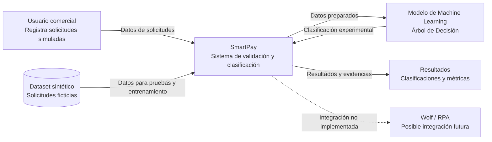

# 03. Arquitectura del sistema y diagrama C4 de contexto

## 1. Introducción

SmartPay es un prototipo académico orientado al registro, validación y clasificación de solicitudes simuladas de aplicación de pagos de cartera de créditos, mediante reglas de negocio y técnicas de Machine Learning.

Su arquitectura permite organizar los componentes encargados de generar y procesar los datos, validar las condiciones de las solicitudes, entrenar el modelo de clasificación y analizar los resultados obtenidos.

El sistema fue desarrollado en Python y utiliza información sintética, por lo que no realiza conexiones con sistemas bancarios reales ni ejecuta operaciones financieras.

## 2. Objetivo de la arquitectura

La arquitectura de SmartPay tiene como objetivos:

- Organizar los componentes principales del prototipo.
- Separar las validaciones de negocio del modelo de Machine Learning.
- Facilitar el procesamiento y almacenamiento de los datos sintéticos.
- Permitir el entrenamiento y evaluación del modelo.
- Mantener una estructura modular que facilite futuras mejoras.
- Delimitar las funcionalidades implementadas y las posibles integraciones futuras.

## 3. Componentes principales

La solución se organiza en los siguientes componentes:

### 3.1. Usuario comercial

Representa al usuario encargado de registrar solicitudes simuladas de aplicación de pagos. Proporciona los datos necesarios para evaluar las condiciones de cada operación.

### 3.2. Módulo de generación de datos

Se encarga de crear el conjunto de datos sintéticos utilizado durante el desarrollo y entrenamiento del modelo.

El archivo principal asociado es:

`src/generar_dataset.py`

Los datos generados se almacenan en:

`data/raw/solicitudes_smartpay.csv`

### 3.3. Módulo de validaciones

Contiene las funciones encargadas de verificar las condiciones de las solicitudes, como:

- Campos obligatorios.
- Longitud de los números de cuenta y crédito.
- Tipo de operación.
- Valores asociados a la operación.
- Condiciones de validación definidas para el prototipo.

Archivo principal:

`src/validaciones.py`

### 3.4. Módulo de preprocesamiento

Prepara los datos para el entrenamiento del modelo mediante selección de variables, generación de indicadores, transformación de variables categóricas y división de los conjuntos de entrenamiento y prueba.

Archivo principal:

`src/preprocesamiento.py`

### 3.5. Módulo de entrenamiento

Implementa el algoritmo de Árbol de Decisión utilizando la biblioteca scikit-learn.

Su función es aprender patrones de los datos de entrenamiento y generar el modelo utilizado para la clasificación experimental.

Archivo principal:

`src/entrenamiento.py`

### 3.6. Módulo de evaluación

Analiza el desempeño del modelo mediante métricas de clasificación y matriz de confusión.

Se utilizan indicadores como Accuracy, Precision, Recall y F1-score.

Archivo principal:

`src/evaluacion.py`

### 3.7. Almacenamiento de resultados

El proyecto organiza sus archivos en diferentes directorios:

- `data/raw/`: almacena los datos sintéticos originales.
- `data/processed/`: almacena los datos transformados.
- `models/`: conserva el modelo entrenado.
- `reports/graficas/`: almacena las visualizaciones.
- `reports/metricas/`: conserva los resultados de evaluación.
- `docs/`: contiene la documentación técnica y académica.

## 4. Diagrama C4 de contexto

El diagrama C4 de contexto representa el sistema SmartPay y su relación con los usuarios y elementos externos.

**Interpretación del diagrama:**

El usuario comercial representa el actor que proporciona la información de las solicitudes. SmartPay procesa los datos mediante sus reglas de validación y utiliza el modelo de Machine Learning para realizar una clasificación experimental.

El dataset sintético proporciona la información necesaria para las pruebas y el entrenamiento. Finalmente, el sistema genera resultados y evidencias que permiten analizar el comportamiento del modelo.

La integración con Wolf o herramientas RPA se representa como una posibilidad futura y no como una funcionalidad implementada.

## 5. Flujo general de funcionamiento

El funcionamiento conceptual del prototipo comprende las siguientes etapas:

1. Generación o selección de solicitudes sintéticas.
2. Registro de la información correspondiente a cada solicitud.
3. Verificación de los campos obligatorios.
4. Aplicación de las validaciones de cuenta, crédito y reglas de negocio.
5. Preparación de los datos mediante el módulo de preprocesamiento.
6. Entrenamiento del modelo de Árbol de Decisión.
7. Evaluación de las predicciones mediante métricas y matriz de confusión.
8. Generación de resultados y evidencias para el análisis académico.

Las validaciones determinísticas constituyen controles independientes del modelo. La clasificación experimental no reemplaza las reglas de negocio ni autoriza operaciones financieras.

## 6. Tecnologías utilizadas

| Tecnología | Uso en el proyecto |
|---|---|
| Python | Lenguaje principal de desarrollo. |
| Pandas | Organización y manipulación de datos. |
| NumPy | Operaciones y procesamiento numérico. |
| scikit-learn | Entrenamiento y evaluación del modelo. |
| Matplotlib | Generación de gráficos y visualizaciones. |
| Joblib | Almacenamiento del modelo entrenado. |
| Git y GitHub | Control de versiones y gestión del repositorio. |
| Visual Studio Code | Entorno de desarrollo. |

## 7. Alcance de la arquitectura

La arquitectura corresponde a un prototipo académico ejecutado localmente.

### Funcionalidades contempladas

- Generación de solicitudes sintéticas.
- Validación de datos y reglas de negocio.
- Preprocesamiento de información.
- Entrenamiento de un Árbol de Decisión.
- Evaluación del modelo mediante métricas.
- Generación de gráficos y evidencias.

### Funcionalidades fuera del alcance

- Conexión con sistemas bancarios de producción.
- Consulta de información real de clientes.
- Ejecución de débitos o pagos.
- Modificación de cuentas o créditos.
- Integración operativa con Wolf.
- Ejecución de procesos RPA.
- Autorización automática de operaciones mediante Machine Learning.

## 8. Seguridad y uso responsable

SmartPay utiliza datos sintéticos para evitar la exposición de información financiera